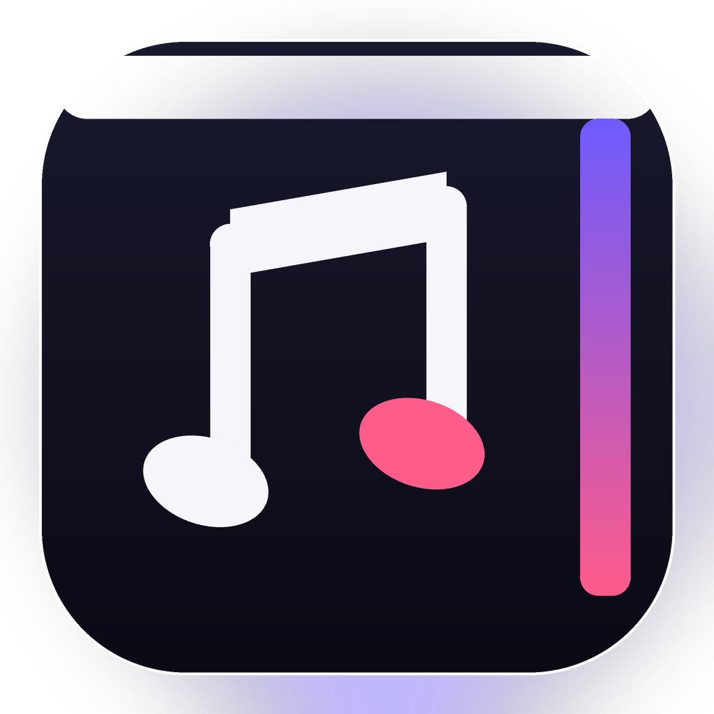
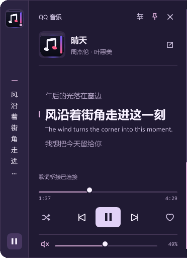

<p align="center">
  
</p>

<h1 align="center">MusicEdgeX</h1>

<p align="center">
  <b>🎵 鼠标轻触边缘，歌词与音乐一起滑出</b>
  <br/>
  <i>Hover the screen edge — your lyrics and player glide out.</i>
</p>

<p align="center">
  
  
  
  
  
  
</p>

<p align="center">
  <a href="#chinese">中文</a> &nbsp;·&nbsp;
  <a href="#english">English</a>
</p>

---

<details open>
<summary><b>🇨🇳 中文</b></summary>

## 这是什么？

你是否有过这样的烦恼：QQ 音乐 / Spotify 挂在任务栏占地方，最小化到托盘又不方便切歌、收藏？

**MusicEdgeX** 把播放控制和当句歌词放在屏幕边缘。鼠标靠近时出现窄歌词轨，继续悬停展开面板，离开后自动收起。

> **Windows SMTC** 提供受支持音乐客户端的曲目信息、进度和播放控制。**PlayerCap** 本地桥接可补充同步歌词、译文和封面。

### 播放来源

MusicEdgeX 识别 QQ 音乐、网易云音乐、Spotify、Apple Music、酷狗音乐和汽水音乐的客户端标识。进度跳转、切歌和随机播放取决于客户端上报的 SMTC 能力。浏览器和视频应用的音频会话会被过滤。

- 有音乐在播放时，优先显示正在播放的音乐客户端。多个音乐客户端同时播放时，优先 Windows 当前音乐会话。
- 暂停的歌曲会在其他媒体会话都未播放时保留。浏览器或视频媒体会话开始播放后，面板进入待机。
- PlayerCap 为同一播放器的同一首歌补充歌词和封面。仅有 PlayerCap 曲目信息时，面板可显示歌词，播放控制显示为不可用。
- QQ 音乐支持通过快捷键收藏。QQ 音乐、网易云音乐和 Spotify 提供打开播放器入口。

## 效果演示



```
鼠标靠近屏幕边缘 → 56 DIP 歌词轨 → 悬停 0.3 秒 → 372 DIP 歌词面板
```

### 视觉语言

- **歌词舞台** — 墨紫底上的大字显示当前歌词，译文和前后句提供上下文。播放时换句有一道封面色柔光，开启 Windows 的减少动画设置后静态切换。
- **封面取色** — 歌曲封面显示在缩略图中，取色用于进度、边缘线和选中状态。

## 功能

- **边缘触发** — 鼠标接近屏幕左/右边缘自动浮现，离开自动隐藏
- **边缘歌词** — 收起时显示竖排当句歌词，展开时显示当前句、译文和前后句
- **歌词同步** — PlayerCap 通过本地 WebSocket 提供歌词。可在设置中按 100 ms 调节偏移，正值提前，负值延后
- **可拖动进度** — 点击或拖动进度线跳转（依赖播放器 SMTC 支持）
- **系统音量** — 音量滑块与静音真正控制系统输出
- **随机播放** — 通过 SMTC 切换，支持时按钮会亮起
- **全屏检测** — 全屏看视频 / 打游戏时自动禁用，不打扰
- **托盘图标** — 右键菜单：显示 / 隐藏 / 播放暂停 / 上下一首 / 收藏 / 设置 / 退出
- **实时同步** — 通过 Windows SMTC 读取当前歌曲、艺术家、专辑封面、播放进度
- **定向播放控制** — 面板和托盘只向选中的音乐会话发命令
- **收藏歌曲** — 模拟 QQ 音乐 Ctrl+Alt+F 快捷键一键收藏
- **面板固定** — 一键固定面板，方便频繁操作
- **低功耗边缘检测** — 低层鼠标钩子，鼠标不动时零轮询唤醒
- **设置持久化** — 悬停 / 收起 / 隐藏延迟、吸附边、开机自启、PlayerCap 地址与播放器

## 快速开始

**环境要求：** Windows 11 x64。Windows 10 x64 请参阅 [.NET 10 支持的系统版本](https://github.com/dotnet/core/blob/main/release-notes/10.0/supported-os.md#windows)。

下载 [MusicEdgeX v2.1.0 Windows x64](https://github.com/leavestring/MusicEdgeX/releases/download/v2.1.0/MusicEdgeX_v2.1.0_win-x64.zip)，解压后双击 `MusicEdgeX.exe`。发布包内置 .NET 运行时。

**从源码构建：**
```bash
git clone https://github.com/leavestring/MusicEdgeX.git
cd MusicEdgeX
dotnet build -c Release
```

## 常见问题

**Q: 面板不出来？** — 确保鼠标移到屏幕最右侧边缘。全屏应用会自动禁用。也可右键托盘 → "显示面板"。

**Q: 收藏无效？** — 收藏模拟的是 QQ 音乐 `Ctrl+Alt+F` 快捷键，确保 QQ 音乐正在运行。

**Q: 专辑封面不显示？** — 确保播放器正在播放，且 SMTC 能读取封面（QQ 音乐 / Spotify / 网易云均可）。如果使用 PlayerCap，封面会由桥接事件补齐。

**Q: 没有歌词 / 歌词不滚动？** — 边缘歌词需要 PlayerCap 本地桥接。启动 PlayerCap 后，在设置里保持“连接 PlayerCap 歌词桥接”开启，默认地址 `127.0.0.1:8765`。确认桥接和面板选中同一首歌，可在面板底部查看连接状态。

**Q: 进度拖动无效？** — 部分播放器不实现 SMTC 的 `TryChangePlaybackPosition`。面板会根据当前播放器上报的能力启用拖动。

## 路线图

> 🚧 **v1 是起点，不是终点。** 后续版本将持续演进，欢迎 Star & Watch 关注更新。

| 版本 | 计划内容 | 状态 |
|------|---------|:--:|
| **v1.0** | 右边缘吸附 · SMTC 同步 · 媒体键控制 · 托盘图标 | ✅ 已发布 |
| **v2.0** | 边缘歌词 · PlayerCap 桥接 · 左/右吸附 · 可拖动进度 · 系统音量 | 源码里程碑 |
| **v2.1** | 歌词舞台与换句柔光 · 音乐来源过滤 · 歌词偏移 · 降低空闲开销 | ✅ 当前版本 |
| **v2.2** | 多显示器选择 · 主题预设 | 📋 计划中 |
| **v3.0** | 频谱可视化 · 插件系统 · macOS 支持 | 💡 探索中 |

</details>

<details>
<summary><b>🇺🇸 English</b></summary>

## What is this?

Taskbar too cluttered, but minimizing to tray means you can't skip tracks — every music lover knows this trade-off.

**MusicEdgeX** hides a music panel and the current lyric line at your screen's edge. Hover near the edge and they glide out smoothly. Skip, pause, favorite, adjust volume — all in one fluid motion. Pull away and it vanishes, leaving your desktop perfectly clean.

> **Windows SMTC** supplies track info, progress, and controls for supported music clients. The optional **PlayerCap** bridge adds timed lyrics, translations, and artwork.

### Playback sources

MusicEdgeX recognizes app IDs for QQ Music, NetEase Cloud Music, Spotify, Apple Music, Kugou Music, and Qishui Music. Transport and seek depend on the capabilities the client reports through SMTC.

- Playing music takes priority. If multiple supported clients are playing, the current Windows music session wins.
- The panel keeps a paused song visible while other media sessions are quiet. Playing audio in a browser or video session by itself puts the panel in standby.
- PlayerCap enriches the same song from the same client. Bridge-only playback displays song info and lyrics, with transport controls disabled.

## Demo


```
Mouse near screen edge → 56 DIP lyric rail → hover 0.3 s → 372 DIP lyric panel
```

### Visual language

- **Lyric stage** — the current line leads on a deep plum surface, with the translation and adjacent lines nearby. A brief cover-colored light sweep follows line changes and respects Windows' animation setting.
- **Cover-derived accent** — the thumbnail supplies color for the timeline, edge progress line, and selected controls.

## Features

- **Edge Trigger** — panel glides out when the mouse approaches the left/right screen edge; auto-hides when you leave
- **Edge Lyrics** — a vertical lyric rail when collapsed, with the current line, translation and adjacent lines in the expanded panel
- **Lyric Timing** — PlayerCap supplies lyrics. Adjust timing in 100 ms steps. Positive values show lyrics earlier and negative values delay them
- **Seek** — click or drag the progress line (depends on the player's SMTC support)
- **System Volume** — the volume slider and mute actually control the default output device
- **Shuffle** — toggled through SMTC; the button lights up when supported
- **Fullscreen Detection** — automatically hidden during games / fullscreen video
- **System Tray** — right-click menu: Show / Hide / Play-Pause / Previous / Next / Favorite / Settings / Exit
- **Session Controls** — panel and tray commands target the selected music session
- **Favorite** — toggles QQ Music like via `Ctrl+Alt+F`
- **Pin Panel** — keep the panel open with one click
- **Low-power Edge Detection** — a low-level mouse hook instead of a constant polling timer
- **Persistent Settings** — delays, edge side, auto-start, PlayerCap host and pinned player

## Getting Started

**Requirements:** Windows 11 x64. For Windows 10 x64, see the [.NET 10 supported versions](https://github.com/dotnet/core/blob/main/release-notes/10.0/supported-os.md#windows).

Download [MusicEdgeX v2.1.0 for Windows x64](https://github.com/leavestring/MusicEdgeX/releases/download/v2.1.0/MusicEdgeX_v2.1.0_win-x64.zip), extract it, and open `MusicEdgeX.exe`. The package includes the .NET runtime.

**Build from source:**
```bash
git clone https://github.com/leavestring/MusicEdgeX.git
cd MusicEdgeX
dotnet build -c Release
```

## FAQ

**Q: Panel won't show?** — Move mouse to the far right edge of the screen. Fullscreen apps auto-disable the panel. Or right-click tray → "Show Panel".

**Q: Favorite doesn't work?** — It sends QQ Music's `Ctrl+Alt+F` shortcut. Make sure QQ Music is running with default hotkeys.

**Q: No album art?** — Ensure a track is playing and SMTC can read its thumbnail (works with QQ Music, Spotify, NetEase). With PlayerCap enabled, artwork is filled in from the bridge.

**Q: No lyrics / lyrics don't move?** — Edge lyrics require the PlayerCap local bridge. Keep the PlayerCap bridge enabled in Settings. The default endpoint is `127.0.0.1:8765`. Check that the bridge and panel show the same song.

**Q: Seeking does nothing?** — Some players do not implement SMTC `TryChangePlaybackPosition`. The timeline accepts input when the player reports seek support.

## Roadmap

> 🚧 **v1 is just the beginning.** More features are on the way — Star & Watch to stay tuned.

| Version | Planned Features | Status |
|---------|-----------------|:--:|
| **v1.0** | Right-edge trigger · SMTC sync · Media keys · Tray icon | ✅ Released |
| **v2.0** | Edge lyrics · PlayerCap bridge · Left/right edge · Seek · System volume | Source milestone |
| **v2.1** | Lyric stage and light sweep · Music source filtering · Lyric offset · Lower idle overhead | ✅ Current |
| **v2.2** | Monitor picker · Theme presets | 📋 Planned |
| **v3.0** | Spectrum visualizer · Plugin system · macOS support | 💡 Exploring |

</details>

---

## 技术栈 / Tech Stack

| Layer | Tech |
|-------|------|
| UI | WPF (.NET 10) |
| Window management | Win32 P/Invoke |
| Animation | `CompositionTarget.Rendering` + physical-pixel `SetWindowPos` |
| Track data | Windows SMTC + optional PlayerCap WebSocket bridge |
| Lyrics | PlayerCap `all_lyrics` / `lyric_update` events |
| Media control | Targeted SMTC commands and the QQ Music favorite shortcut |
| Volume | Core Audio `IAudioEndpointVolume` |
| Edge detection | Low-level mouse hook (`WH_MOUSE_LL`), zero idle polling |

## 项目结构 / Project Structure

```
MusicEdgeX/
├── App.xaml.cs              # Entry point + tray icon
├── MainWindow.xaml / .cs    # Panel UI + animation engine
├── SettingsWindow.xaml / .cs
├── Services/
│   ├── EdgeDetector.cs        # Mouse hook + hover timing
│   ├── SMTCMusicService.cs    # SMTC track info + transport
│   ├── PlayerCapService.cs    # Local PlayerCap WS bridge
│   ├── MusicSourceManager.cs  # SMTC / PlayerCap merge + position clock
│   ├── SystemVolumeService.cs # Core Audio master volume
│   ├── MusicPlayers.cs        # Recognized music client identities
│   ├── MediaKeyService.cs     # Keyboard input for the QQ Music shortcut
│   ├── QQMusicHotkeyService.cs
│   └── SettingsService.cs     # JSON settings + auto-start
├── Helpers/
│   └── Win32Interop.cs       # P/Invoke declarations
└── Models/
    ├── TrackInfo.cs
    ├── LyricLine.cs
    └── AppSettings.cs
```

## 回归验证 / Regression checks

```powershell
dotnet run --project tests/MusicEdgeX.Tests.csproj -c Release
```

## License

MIT © 2025
