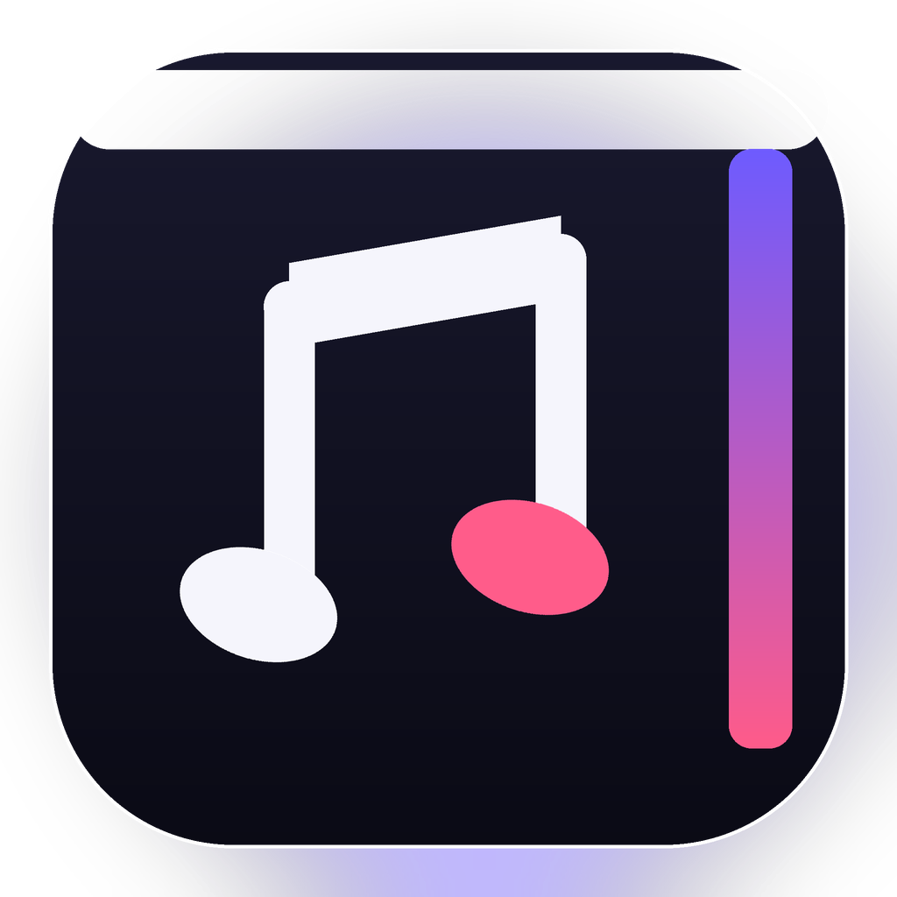

<p align="center">
  
</p>

<h1 align="center">MusicEdgeX</h1>

<p align="center">
  <b>🎵 鼠标轻触边缘，歌词与音乐一起滑出</b>
  <br/>
  <i>Hover the screen edge — your lyrics and player glide out.</i>
</p>

<p align="center">
  
  
  
  
  
  
</p>

<p align="center">
  <a href="#chinese">中文</a> &nbsp;·&nbsp;
  <a href="#english">English</a>
</p>

---

<details open>
<summary><b>🇨🇳 中文</b></summary>

## 这是什么？

你是否有过这样的烦恼：QQ 音乐 / Spotify 挂在任务栏占地方，最小化到托盘又不方便切歌、收藏？

**MusicEdgeX** 把音乐控制栏和当句歌词"藏"在屏幕边缘。平时完全隐形，鼠标轻轻靠近，面板就会丝滑滑出——切歌、暂停、收藏、调音量一气呵成。鼠标离开后自动收回，不占任何屏幕空间。

> 零配置走 **Windows SMTC**：歌名、封面、进度、播放控制开箱即用。<br/>
> 接入 **PlayerCap** 本地桥接后，额外获得**逐字歌词、精确进度与更完整的封面**。

### 为什么不是又一个迷你播放器？

大多数音乐小组件把歌词塞进一个小窗口；MusicEdgeX 把歌词放回屏幕边缘：

- 收起时，边缘只剩一条 **56px 的竖排歌词**，像书页的书脊，不打断桌面。
- 展开时，是 **上一句 / 当前句 / 下一句** 的三行诗页，当前句用衬线字体放大。
- 颜色只从封面取一条细线，不用整屏渐变；控制键保持中性，让歌词成为主角。

这是“边缘原生”的听歌方式：**不占空间，却一直知道在唱什么。**

| 功能 | QQ 音乐 | Spotify | 网易云 | Apple Music |
|------|:--:|:--:|:--:|:--:|
| 歌名 / 歌手 / 封面 / 进度 | ✅ | ✅ | ✅ | ✅ |
| 播放 / 暂停 / 上首 / 下首 | ✅ | ✅ | ✅ | ✅ |
| 拖动进度 / 系统音量 / 随机播放 | ✅ | ✅ | ✅ | ✅ |
| 边缘歌词（PlayerCap） | ✅ | ✅ | ✅ | ✅ |
| 收藏 ❤️ / 打开播放器 🎧 | ✅ | ❌ | ❌ | ❌ |

> 歌词与精确进度来自 PlayerCap 的本地 WebSocket 事件；未运行 PlayerCap 时自动回退到 SMTC，不影响基础控制。

## 效果演示

> *（请替换为你的 GIF 截图）*

```
鼠标靠近右边缘 → 56px 歌词轨滑出 → 悬停 0.3s → 372px 完整面板展开
竖排歌词 · 三行歌词页 · 拖动进度 · 播放 / 暂停 · 上一首 / 下一首 · 随机播放 · 收藏 · 系统音量
```

## 功能

- **边缘触发** — 鼠标接近屏幕左/右边缘自动浮现，离开自动隐藏
- **边缘歌词** — 收起时显示竖排当句歌词，展开时显示上一句 / 当前句 / 下一句
- **PlayerCap 增强** — 通过本地 WebSocket 获取逐字歌词、精确进度与封面；未连接时自动回退 SMTC
- **可拖动进度** — 点击或拖动进度线跳转（依赖播放器 SMTC 支持）
- **系统音量** — 音量滑块与静音真正控制系统输出
- **随机播放** — 通过 SMTC 切换，支持时按钮会亮起
- **封面取色** — 只提取一条强调色，用于边缘细线、进度和当前歌词标记
- **全屏检测** — 全屏看视频 / 打游戏时自动禁用，不打扰
- **托盘图标** — 右键菜单：显示 / 隐藏 / 播放暂停 / 上下一首 / 收藏 / 设置 / 退出
- **实时同步** — 通过 Windows SMTC 读取当前歌曲、艺术家、专辑封面、播放进度
- **SMTC 优先控制** — 优先向当前媒体会话发送命令，失败时回退到媒体键
- **收藏歌曲** — 模拟 QQ 音乐 Ctrl+Alt+F 快捷键一键收藏
- **面板固定** — 一键固定面板，方便频繁操作
- **低功耗边缘检测** — 低层鼠标钩子，鼠标不动时零轮询唤醒
- **设置持久化** — 悬停 / 收起 / 隐藏延迟、吸附边、开机自启、PlayerCap 地址与播放器

## 快速开始

**环境要求：** Windows 10 1809+ 或 Windows 11

**下载：** 前往 [Releases](https://github.com/leavestring/MusicEdgeX/releases) 下载最新 `MusicEdgeX_v2.0.0.zip`，解压即用，无需安装任何运行时。

**从源码构建：**
```bash
git clone https://github.com/leavestring/MusicEdgeX.git
cd MusicEdgeX
dotnet build -c Release
```

## 常见问题

**Q: 面板不出来？** — 确保鼠标移到屏幕最右侧边缘。全屏应用会自动禁用。也可右键托盘 → "显示面板"。

**Q: 收藏无效？** — 收藏模拟的是 QQ 音乐 `Ctrl+Alt+F` 快捷键，确保 QQ 音乐正在运行。

**Q: 专辑封面不显示？** — 确保播放器正在播放，且 SMTC 能读取封面（QQ 音乐 / Spotify / 网易云均可）。如果使用 PlayerCap，封面会由桥接事件补齐。

**Q: 没有歌词 / 歌词不滚动？** — 边缘歌词需要 PlayerCap 本地桥接。启动 PlayerCap 后，在设置里保持“连接 PlayerCap 本地桥接”开启，默认地址 `127.0.0.1:8765`。未连接时面板会显示“正在聆听”，基础控制不受影响。

**Q: 进度拖动无效？** — 部分播放器不实现 SMTC 的 `TryChangePlaybackPosition`。进度仍会正常显示，拖动会在不支持时提示。

## 路线图

> 🚧 **v1 是起点，不是终点。** 后续版本将持续演进，欢迎 Star & Watch 关注更新。

| 版本 | 计划内容 | 状态 |
|------|---------|:--:|
| **v1.0** | 右边缘吸附 · SMTC 同步 · 媒体键控制 · 托盘图标 | ✅ 已发布 |
| **v2.0** | 边缘歌词 · PlayerCap 桥接 · 左/右吸附 · 可拖动进度 · 系统音量 · 新视觉 | ✅ 当前版本 |
| **v2.1** | 歌词偏移微调 · 多显示器选择 · 主题预设 | 📋 计划中 |
| **v3.0** | 频谱可视化 · 插件系统 · macOS 支持 | 💡 探索中 |

</details>

<details>
<summary><b>🇺🇸 English</b></summary>

## What is this?

Taskbar too cluttered, but minimizing to tray means you can't skip tracks — every music lover knows this trade-off.

**MusicEdgeX** hides a music panel and the current lyric line at your screen's edge. Hover near the edge and they glide out smoothly. Skip, pause, favorite, adjust volume — all in one fluid motion. Pull away and it vanishes, leaving your desktop perfectly clean.

> **SMTC** works out of the box: track, cover, progress and transport controls.<br/>
> Add the **PlayerCap** local bridge for **timed lyrics, precise position and richer artwork**.

### Not another mini player

Most music widgets squeeze lyrics into a small window. MusicEdgeX puts them back on the screen edge:

- Collapsed, only a **56px vertical lyric rail** remains — a quiet book spine for your desktop.
- Expanded, it becomes a **previous / current / next** three-line lyric page, with the current line set in serif type.
- Color comes from a single cover-derived hairline, not a full-screen gradient; controls stay neutral so the lyric is the hero.

It is an edge-native way to listen: **no space taken, yet you always know what is being sung.**

| Feature | QQ Music | Spotify | NetEase | Apple Music |
|---------|:--:|:--:|:--:|:--:|
| Track info / album art / progress | ✅ | ✅ | ✅ | ✅ |
| Play / pause / next / previous | ✅ | ✅ | ✅ | ✅ |
| Seek / system volume / shuffle | ✅ | ✅ | ✅ | ✅ |
| Edge lyrics (via PlayerCap) | ✅ | ✅ | ✅ | ✅ |
| Favorite ❤️ / Open player 🎧 | ✅ | ❌ | ❌ | ❌ |

> Lyrics and precise position come from PlayerCap's local WebSocket events. Without PlayerCap, MusicEdgeX falls back to SMTC and all core controls still work.

## Demo

> *(Replace with your GIF)*

```
Mouse near right edge → 56px lyric rail slides out → hover 0.3s → full 372px panel
Vertical lyric · three-line lyric page · seek · Play / Pause · Previous / Next · Shuffle · Favorite · System volume
```

## Features

- **Edge Trigger** — panel glides out when the mouse approaches the left/right screen edge; auto-hides when you leave
- **Edge Lyrics** — vertical current line when collapsed; previous / current / next page when expanded
- **PlayerCap Enhancement** — timed lyrics, precise position and artwork through a local WebSocket bridge; falls back to SMTC
- **Seek** — click or drag the progress line (depends on the player's SMTC support)
- **System Volume** — the volume slider and mute actually control the default output device
- **Shuffle** — toggled through SMTC; the button lights up when supported
- **Cover-Derived Accent** — one hairline color for the edge line, progress and lyric marker
- **Fullscreen Detection** — automatically hidden during games / fullscreen video
- **System Tray** — right-click menu: Show / Hide / Play-Pause / Previous / Next / Favorite / Settings / Exit
- **SMTC-first Controls** — commands go to the active media session, with a media-key fallback
- **Favorite** — toggles QQ Music like via `Ctrl+Alt+F`
- **Pin Panel** — keep the panel open with one click
- **Low-power Edge Detection** — a low-level mouse hook instead of a constant polling timer
- **Persistent Settings** — delays, edge side, auto-start, PlayerCap host and pinned player

## Getting Started

**Requirements:** Windows 10 1809+ or Windows 11

**Download:** Grab the latest `MusicEdgeX_v2.0.0.zip` from [Releases](https://github.com/leavestring/MusicEdgeX/releases), unzip and double-click `MusicEdgeX.exe` — no runtime installation needed.

**Build from source:**
```bash
git clone https://github.com/leavestring/MusicEdgeX.git
cd MusicEdgeX
dotnet build -c Release
```

## FAQ

**Q: Panel won't show?** — Move mouse to the far right edge of the screen. Fullscreen apps auto-disable the panel. Or right-click tray → "Show Panel".

**Q: Favorite doesn't work?** — It sends QQ Music's `Ctrl+Alt+F` shortcut. Make sure QQ Music is running with default hotkeys.

**Q: No album art?** — Ensure a track is playing and SMTC can read its thumbnail (works with QQ Music, Spotify, NetEase). With PlayerCap enabled, artwork is filled in from the bridge.

**Q: No lyrics / lyrics don't move?** — Edge lyrics require the PlayerCap local bridge. Keep "Connect PlayerCap" enabled in Settings; the default endpoint is `127.0.0.1:8765`. Without it the panel shows a neutral listening state and all core controls still work.

**Q: Seeking does nothing?** — Some players do not implement SMTC `TryChangePlaybackPosition`. Progress still displays; seeking shows a message when unsupported.

## Roadmap

> 🚧 **v1 is just the beginning.** More features are on the way — Star & Watch to stay tuned.

| Version | Planned Features | Status |
|---------|-----------------|:--:|
| **v1.0** | Right-edge trigger · SMTC sync · Media keys · Tray icon | ✅ Released |
| **v2.0** | Edge lyrics · PlayerCap bridge · Left/right edge · Seek · System volume · New visual system | ✅ Current |
| **v2.1** | Lyric offset · Monitor picker · Theme presets | 📋 Planned |
| **v3.0** | Spectrum visualizer · Plugin system · macOS support | 💡 Exploring |

</details>

---

## 技术栈 / Tech Stack

| Layer | Tech |
|-------|------|
| UI | WPF (.NET 10) |
| Window management | Win32 P/Invoke |
| Animation | `CompositionTarget.Rendering` + physical-pixel `SetWindowPos` |
| Track data | Windows SMTC + optional PlayerCap WebSocket bridge |
| Lyrics | PlayerCap `all_lyrics` / `lyric_update` events |
| Media control | SMTC commands, `SendInput` media-key fallback |
| Volume | Core Audio `IAudioEndpointVolume` |
| Edge detection | Low-level mouse hook (`WH_MOUSE_LL`), zero idle polling |

## 项目结构 / Project Structure

```
MusicEdgeX/
├── App.xaml.cs              # Entry point + tray icon
├── MainWindow.xaml / .cs    # Panel UI + animation engine
├── SettingsWindow.xaml / .cs
├── Services/
│   ├── EdgeDetector.cs        # Mouse hook + hover timing
│   ├── SMTCMusicService.cs    # SMTC track info + transport
│   ├── PlayerCapService.cs    # Local PlayerCap WS bridge
│   ├── MusicSourceManager.cs  # SMTC / PlayerCap merge + position clock
│   ├── SystemVolumeService.cs # Core Audio master volume
│   ├── MediaKeyService.cs     # Non-blocking SendInput fallback
│   ├── QQMusicHotkeyService.cs
│   └── SettingsService.cs     # JSON settings + auto-start
├── Helpers/
│   └── Win32Interop.cs       # P/Invoke declarations
└── Models/
    ├── TrackInfo.cs
    ├── LyricLine.cs
    └── AppSettings.cs
```

## License

MIT © 2025
